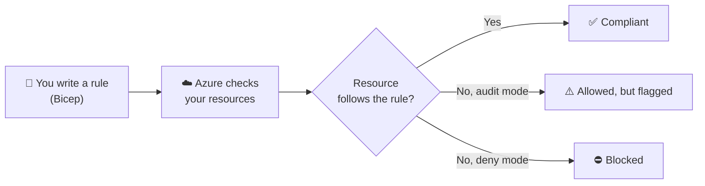
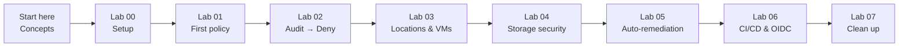
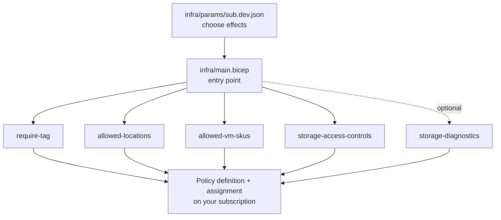
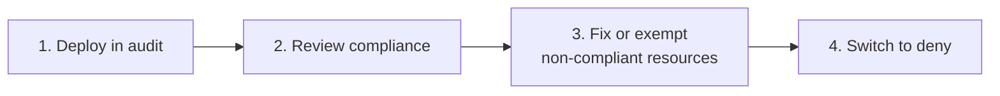
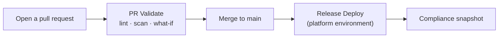

# Governance-with-Bicep

**Learn Azure Policy as Code, hands-on.** Write governance rules in **Bicep**, test them safely, and ship them with **GitHub Actions**. No prior policy experience needed.

> **Use a sandbox subscription.** Policies in `deny` mode can block real deployments. Everything here starts in safe `audit` mode and is removed by the last lab.

## What is this, in 30 seconds?



Example rule: *"Every resource must have an `Environment` tag."*

## Your learning path



| Level | Lab | You will | Time |
|---|---|---|---|
| 🟢 Beginner | [00 Setup](docs/labs/00-setup.md) | Install tools, sign in | 10 min |
| 🟢 Beginner | [01 First policy](docs/labs/01-first-policy.md) | Deploy in audit mode, see a violation | 15 min |
| 🟢 Beginner | [02 Audit to deny](docs/labs/02-audit-to-deny.md) | Block a bad resource | 15 min |
| 🟡 Intermediate | [03 Locations and VM sizes](docs/labs/03-locations-and-vm-skus.md) | Test two allowlist policies | 15 min |
| 🟡 Intermediate | [04 Storage security](docs/labs/04-storage-security.md) | Catch insecure storage accounts | 15 min |
| 🟡 Intermediate | [05 Auto-remediation](docs/labs/05-remediation.md) | Let Azure fix things for you | 20 min |
| 🔴 Advanced | [06 CI/CD with OIDC](docs/labs/06-ci-cd-with-oidc.md) | Validate and deploy from GitHub | 20 min |
| 🧹 Wrap-up | [07 Clean up](docs/labs/07-clean-up.md) | Remove everything | 5 min |

**New here?** Read [Concepts](docs/concepts.md) first. **Stuck?** [Troubleshooting](docs/troubleshooting.md) · [FAQ](docs/faq.md) · [Glossary](docs/glossary.md)

## Prerequisites
- An Azure subscription where you can create policies (Owner, or Resource Policy Contributor)
- [Azure CLI](https://learn.microsoft.com/cli/azure/install-azure-cli) with Bicep (`az bicep install`)
- Optional for Lab 06: a GitHub account and the [GitHub CLI](https://cli.github.com/)

## Try it in 5 minutes
```bash
az login
az account set --subscription <SUB_ID>

az deployment sub what-if --location eastus2 --template-file infra/main.bicep --parameters infra/params/sub.dev.json   # preview only
az deployment sub create  --location eastus2 --template-file infra/main.bicep --parameters infra/params/sub.dev.json   # deploy (audit mode)
az policy state summarize                                                                                              # results can take up to 30 min
```

## How the repo works



| Folder | What's inside |
|---|---|
| `infra/` | `main.bicep`, one module per policy, parameter files, sample test resources |
| `docs/` | [Concepts](docs/concepts.md), [labs](docs/labs/README.md), FAQ, glossary, troubleshooting |
| `scripts/` | `setup-oidc`, `test-noncompliant`, `cleanup` (each as `.sh` and `.ps1`) |
| `.github/workflows/` | PR validation and release deployment |

## The policies

| Policy | What it checks | Effect parameter |
|---|---|---|
| `require-tag` | Has an `Environment` tag | `requireTagEffect` |
| `allowed-locations` | Only approved regions | `allowedLocationsEffect` |
| `allowed-vm-skus` | Only approved VM sizes | `allowedVmSkusEffect` |
| `storage-access-controls` | No anonymous access or shared keys, TLS 1.2+ | `storageAccessControlsEffect` |
| `storage-diagnostics` *(optional)* | Logs go to Log Analytics | `storageDiagnosticsEffect` |

Safe rollout for any policy:



Details and allowed values: [infra/modules/README.md](infra/modules/README.md). `sub.prod.json` enforces everything, so read [infra/params/README.md](infra/params/README.md) first.

## Automated deployment



GitHub signs in to Azure with **OIDC** (a short-lived token, no stored password). Run `scripts/setup-oidc.sh <owner/repo>` (or `setup-oidc.ps1 -Repo <owner/repo>`) to set it up. Details: [Lab 06](docs/labs/06-ci-cd-with-oidc.md).

## Clean up
```bash
scripts/cleanup.sh      # or scripts/cleanup.ps1
```

## Contributing
Found a confusing step? [Open an issue](../../issues/new/choose) or read [CONTRIBUTING](CONTRIBUTING.md).

## Good to know
- Everything deploys at **subscription** scope. For production, consider management groups and initiatives.
- Changing a policy's `policyName` creates a new definition and leaves the old one behind.
