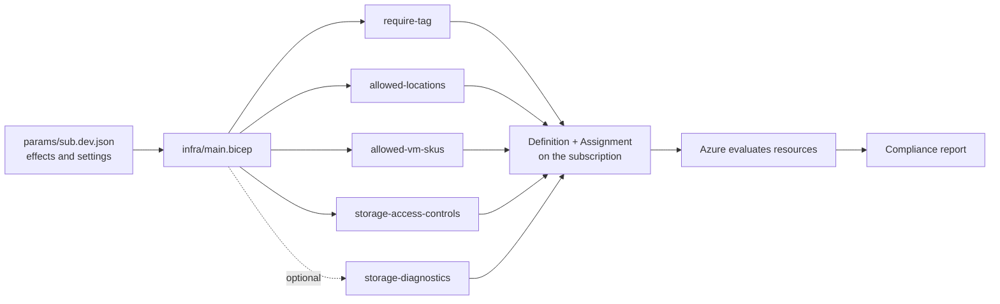

# Concepts

A five-minute tour of the ideas behind this repo.

## The big picture

You edit **parameters**, `main.bicep` calls one **module** per policy, and each module creates a **definition** and an **assignment**. Azure then evaluates your resources and reports compliance.

## Definition vs assignment
- A **definition** is the rule, written as `if <condition> then <effect>`.
- An **assignment** activates a definition at a **scope**. A definition with no assignment does nothing.

## Effects
| Effect | What happens | Use it to |
|---|---|---|
| `audit` | Resource is allowed and flagged non-compliant | Learn what would break (start here) |
| `deny` | The request is rejected | Enforce a rule |
| `auditIfNotExists` | Flags a resource missing a related setting | Find missing diagnostics |
| `deployIfNotExists` | Creates the missing related resource | Auto-fix |

Safe rollout: **audit, review compliance, fix or exempt, then deny.**

## Scope
Assignments can target a management group, subscription, resource group, or single resource. This repo uses the **subscription**. Larger organizations usually use management groups and **initiatives** (bundles of policies).

## Bicep modules
A module is a reusable Bicep file. Here, each policy is one module with parameters such as `effect` and `policyName`, so `main.bicep` stays short.

## What-if
`az deployment sub what-if` previews a deployment without changing anything. Run it before every deploy.

## OIDC
GitHub Actions signs in to Azure with a short-lived token instead of a stored password.

More terms: [glossary](glossary.md). Common questions: [FAQ](faq.md).
