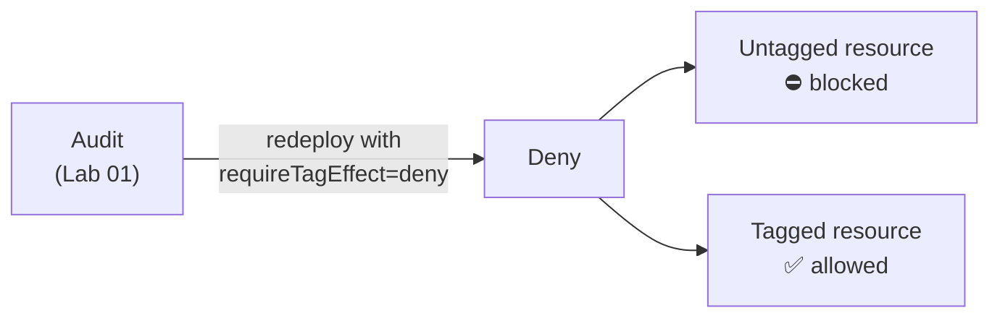

# Lab 02: From audit to deny

**Goal:** make the tag policy block non-compliant resources.



## 1. Switch the effect
Override one parameter on the command line (no file edit needed):

```bash
az deployment sub create --location eastus2 \
  --template-file infra/main.bicep \
  --parameters infra/params/sub.dev.json requireTagEffect=deny
```

```powershell
az deployment sub create --location eastus2 `
  --template-file infra/main.bicep `
  --parameters infra/params/sub.dev.json requireTagEffect=deny
```

To make it permanent, change `requireTagEffect` in `infra/params/sub.dev.json` to `"deny"`.

## 2. Wait a few minutes
New assignments take 5 to 10 minutes to start blocking.

## 3. Try again
```bash
scripts/test-noncompliant.sh tag
```

```powershell
scripts/test-noncompliant.ps1 -Scenario tag
```

## 4. Fix it
Add the tag and the same command succeeds:

```bash
az storage account create -g rg-governance-lab -n labok$RANDOM -l eastus2 --sku Standard_LRS --tags Environment=lab
```

```powershell
az storage account create -g rg-governance-lab -n "labok$(Get-Random -Maximum 99999)" -l eastus2 --sku Standard_LRS --tags Environment=lab
```

## Check yourself
- The untagged attempt fails with `RequestDisallowedByPolicy`.
- The tagged one succeeds.

> **Real-world tip:** always run in audit first and review compliance, as in Lab 01, before turning on deny.

Next: [Lab 03](03-locations-and-vm-skus.md)
